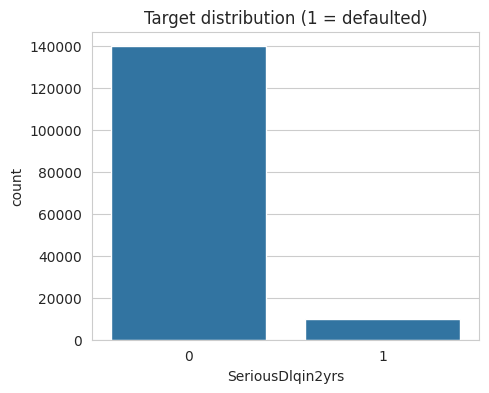
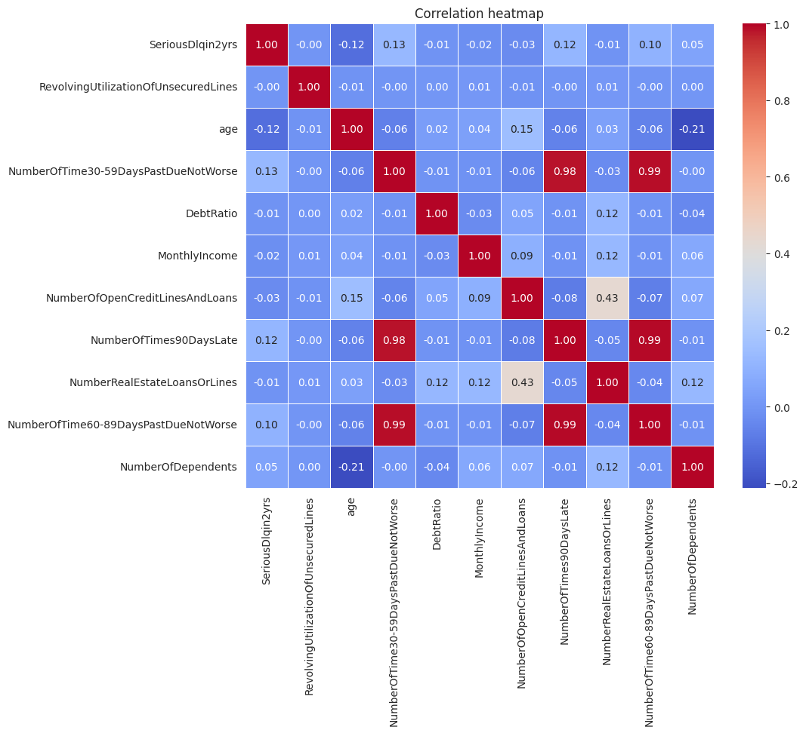
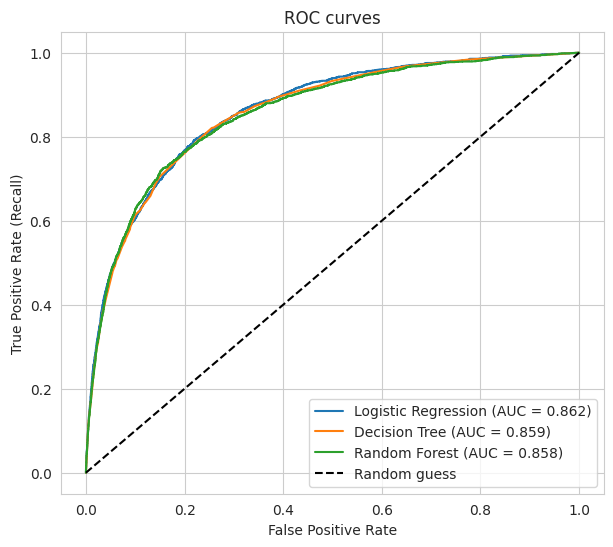
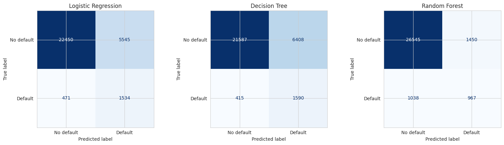
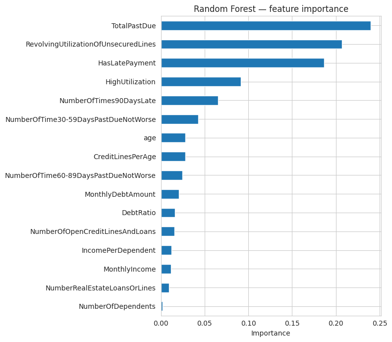

# Credit Scoring Model

**CodeAlpha Machine Learning Internship — Task 1**

[](https://colab.research.google.com/github/Nandishsk-07/CodeAlpha_Credit-Scoring-Model-/blob/main/CodeAlpha_CreditScoringModel.ipynb)

A machine learning project that predicts an individual's **creditworthiness**: the probability that a borrower will face serious financial delinquency (90+ days past due) within the next two years, based on their past financial data.

**Best result:** a tuned Random Forest reached a **ROC-AUC of 0.868** on a held-out test set of 30,000 borrowers, catching **76% of the actual defaulters**.

---

## Table of Contents
- [Overview](#overview)
- [Dataset](#dataset)
- [Workflow](#workflow)
- [Feature Engineering](#feature-engineering)
- [Models Used](#models-used)
- [Evaluation Metrics](#evaluation-metrics)
- [Results](#results)
- [Key Insights](#key-insights)
- [Limitations and Future Work](#limitations-and-future-work)
- [How to Run](#how-to-run)
- [Tech Stack](#tech-stack)
- [Project Structure](#project-structure)
- [Author](#author)

---

## Overview

Banks and lenders must decide who is safe to lend money to. This project builds a **binary classifier** that takes a person's financial history (income, debts, payment behaviour, credit usage) and predicts whether they are likely to **default (1)** or **not default (0)**.

**Highlights**
- Full pipeline: EDA → cleaning → feature engineering → modelling → evaluation → tuning
- Handles real-world data problems: missing values, placeholder error codes, outliers and heavy class imbalance
- Preprocessing is fitted on the training set only, so there is **no data leakage**
- Compares three classifiers using Precision, Recall, F1-Score and ROC-AUC
- Includes feature importance, decision-threshold analysis and an SMOTE vs class-weight comparison
- Saves the final model and shows how to score a new applicant

## Dataset

- **Name:** Give Me Some Credit (Kaggle competition, 2011)
- **Source:** https://www.kaggle.com/competitions/GiveMeSomeCredit
- **File used:** `cs-training.csv` — 150,000 borrowers, 10 input features + 1 target
- **Target:** `SeriousDlqin2yrs` — 1 if the person had 90+ days past due delinquency within 2 years, otherwise 0
- **Class imbalance:** 10,026 defaulters (6.68%) vs 139,974 non-defaulters (93.32%)
- **Missing values:** `MonthlyIncome` (29,731 missing) and `NumberOfDependents` (3,924 missing)

> The dataset is not included in this repository. Download `cs-training.csv` from the Kaggle link above and place it in the same folder as the notebook.

| Feature | Description |
|---|---|
| `RevolvingUtilizationOfUnsecuredLines` | Share of available credit being used |
| `age` | Age of the borrower |
| `NumberOfTime30-59DaysPastDueNotWorse` | Times 30–59 days late |
| `DebtRatio` | Monthly debt payments / monthly income |
| `MonthlyIncome` | Monthly income |
| `NumberOfOpenCreditLinesAndLoans` | Number of open loans and credit cards |
| `NumberOfTimes90DaysLate` | Times 90+ days late |
| `NumberRealEstateLoansOrLines` | Number of mortgage / real estate loans |
| `NumberOfTime60-89DaysPastDueNotWorse` | Times 60–89 days late |
| `NumberOfDependents` | Number of dependents |

<p align="center">
  
  
</p>

## Workflow

1. **Exploratory Data Analysis:** target distribution, feature distributions, correlation heatmap, missing values
2. **Data cleaning**
   - Removed impossible ages (under 18); 1 row dropped, leaving 149,999 rows
   - Treated the placeholder codes 96 and 98 in the late-payment columns as missing values
3. **Feature engineering:** six new features built from financial history (see below)
4. **Train/test split:** 80/20, stratified (119,999 train / 30,000 test, 6.68% defaulters in both)
5. **Preprocessing (fitted on training data only):** median imputation, outlier capping at the 99th percentile, standard scaling
6. **Class imbalance handling:** `class_weight="balanced"`, with an SMOTE comparison
7. **Model training and comparison:** Logistic Regression, Decision Tree, Random Forest
8. **Hyperparameter tuning:** `RandomizedSearchCV` (8 candidates, 3-fold CV) scored on ROC-AUC
9. **Analysis:** feature importance and decision-threshold analysis
10. **Scoring example:** model saved with `joblib` and a sample applicant scored

## Feature Engineering

| New Feature | Meaning |
|---|---|
| `TotalPastDue` | Total number of late payments across all buckets |
| `HasLatePayment` | 1 if the borrower was ever late |
| `IncomePerDependent` | Income divided by household size |
| `MonthlyDebtAmount` | Actual monthly debt = DebtRatio × MonthlyIncome |
| `CreditLinesPerAge` | Open credit lines relative to age |
| `HighUtilization` | 1 if using more than 80% of available credit |

## Models Used

| Model | Why it was chosen |
|---|---|
| **Logistic Regression** | Simple, fast and interpretable baseline |
| **Decision Tree** | Rule-based and easy to explain |
| **Random Forest** | Ensemble of trees; usually strong on tabular data |

## Evaluation Metrics

Accuracy alone is misleading here: predicting "no default" for everyone would already score about 93%. The models are therefore compared using:

- **Precision:** of the people predicted to default, how many really did
- **Recall:** of the people who really defaulted, how many were caught
- **F1-Score:** balance between precision and recall
- **ROC-AUC:** how well the model separates risky from safe borrowers across all thresholds

In credit scoring, **recall on the defaulter class** is especially important, because a missed defaulter costs the lender money. But very high recall with low precision means many good customers get rejected, which is why the decision threshold is analysed as well.

## Results

All metrics are for the **Default (1)** class on the test set (30,000 borrowers, 2,005 of them defaulters), at the default 0.5 threshold.

| Model | Precision | Recall | F1-Score | ROC-AUC |
|---|---|---|---|---|
| Logistic Regression | 0.22 | 0.77 | 0.34 | 0.862 |
| Decision Tree | 0.20 | 0.79 | 0.32 | 0.859 |
| Random Forest | 0.40 | 0.48 | 0.44 | 0.858 |
| **Random Forest (tuned)** | 0.23 | 0.76 | 0.35 | **0.868** |

**Best model:** Tuned Random Forest (test ROC-AUC = 0.868, cross-validated ROC-AUC = 0.861)
**Best hyperparameters:** `n_estimators=300`, `max_depth=8`, `min_samples_leaf=20`, `max_features='log2'`

### ROC Curves


### Confusion Matrices


### Feature Importance (tuned Random Forest)


| Top features | Importance |
|---|---|
| `TotalPastDue` | 0.240 |
| `RevolvingUtilizationOfUnsecuredLines` | 0.207 |
| `HasLatePayment` | 0.187 |
| `HighUtilization` | 0.092 |
| `NumberOfTimes90DaysLate` | 0.065 |

### Decision-threshold analysis (tuned Random Forest)

| Threshold | Precision | Recall | F1-Score |
|---|---|---|---|
| 0.2 | 0.118 | 0.939 | 0.210 |
| 0.3 | 0.147 | 0.894 | 0.252 |
| 0.4 | 0.180 | 0.841 | 0.296 |
| 0.5 | 0.228 | 0.765 | 0.352 |
| 0.6 | 0.298 | 0.653 | 0.409 |
| 0.7 | 0.351 | 0.568 | 0.434 |

### Class weights vs SMOTE (Random Forest, untuned)

| Approach | Precision | Recall | F1-Score | ROC-AUC |
|---|---|---|---|---|
| `class_weight='balanced'` | 0.400 | 0.482 | 0.437 | 0.858 |
| SMOTE | 0.503 | 0.250 | 0.334 | 0.851 |

## Key Insights

- **Tuning helped:** the tuned Random Forest has the best ROC-AUC (0.868), above the untuned models (0.858–0.862). Before tuning, the three models were almost equal in ranking ability, so the differences in precision and recall at the 0.5 threshold mostly reflect *where each model draws its line*, not how well it separates risky from safe borrowers.
- **Payment history and credit usage drive the prediction:** `TotalPastDue`, credit utilization and `HasLatePayment` are the top three features, together accounting for about 63% of the Random Forest's importance. Three of the top four features (`TotalPastDue`, `HasLatePayment`, `HighUtilization`) were engineered in this project. (No ablation study was run, so this shows they are heavily used, not exactly how much they improved the score.)
- **Precision vs recall is a business choice:** at a 0.5 threshold the model catches 76% of defaulters but only 23% of the people it flags actually default. Raising the threshold to 0.7 lifts precision to 35% but recall falls to 57%; lowering it to 0.2 catches 94% of defaulters at 12% precision. A lender must choose based on the cost of a bad loan versus a rejected good customer.
- **Class weights beat SMOTE here:** `class_weight='balanced'` gave a better F1 (0.437 vs 0.334) and ROC-AUC (0.858 vs 0.851) than SMOTE, which gained precision (0.503) but missed most defaulters (recall 0.25).
- **Accuracy would have been misleading:** a model that predicts "no default" for everyone scores about 93% accuracy but catches no defaulters.

## Limitations and Future Work

- The dataset is from 2011 and from a single lender, so the model should not be treated as production-ready for today's borrowers
- Precision for the defaulter class is low at the default threshold; a real system would choose a threshold based on business costs
- No fairness or bias analysis was done; real credit models must be checked for discrimination against protected groups
- Future work: gradient boosting (XGBoost / LightGBM), SHAP explanations for individual decisions, probability calibration, and a Streamlit app for live scoring

## How to Run

**Option 1: Google Colab (recommended)**
1. Click the **Open in Colab** badge above
2. Upload `cs-training.csv` using the Files panel on the left
3. Add a first cell with `!pip install imbalanced-learn` and run it
4. Choose **Runtime → Run all**

**Option 2: Locally**
```bash
git clone https://github.com/Nandishsk-07/CodeAlpha_Credit-Scoring-Model-.git
cd CodeAlpha_Credit-Scoring-Model-
python -m venv venv
venv\Scripts\activate        # Mac/Linux: source venv/bin/activate
pip install -r requirements.txt
jupyter notebook
```
Place `cs-training.csv` in the same folder, open the notebook and run all cells.

## Tech Stack

- Python 3.10+
- Pandas, NumPy
- Scikit-learn
- Imbalanced-learn
- Matplotlib, Seaborn
- Joblib
- Jupyter / Google Colab

## Project Structure

```
CodeAlpha_Credit-Scoring-Model-/
├── CodeAlpha_CreditScoringModel.ipynb   # main notebook
├── README.md
├── requirements.txt
└── images/
    ├── target_distribution.png
    ├── correlation_heatmap.png
    ├── roc_curves.png
    ├── confusion_matrices.png
    └── feature_importance.png
```

## Author

**Nandish**
- GitHub: [@Nandishsk-07](https://github.com/Nandishsk-07)
- LinkedIn: www.linkedin.com/in/nandish-sk-311061360

## Acknowledgements

- Internship by [CodeAlpha](https://www.codealpha.tech)
- Dataset: *Give Me Some Credit*, Credit Fusion and Kaggle
